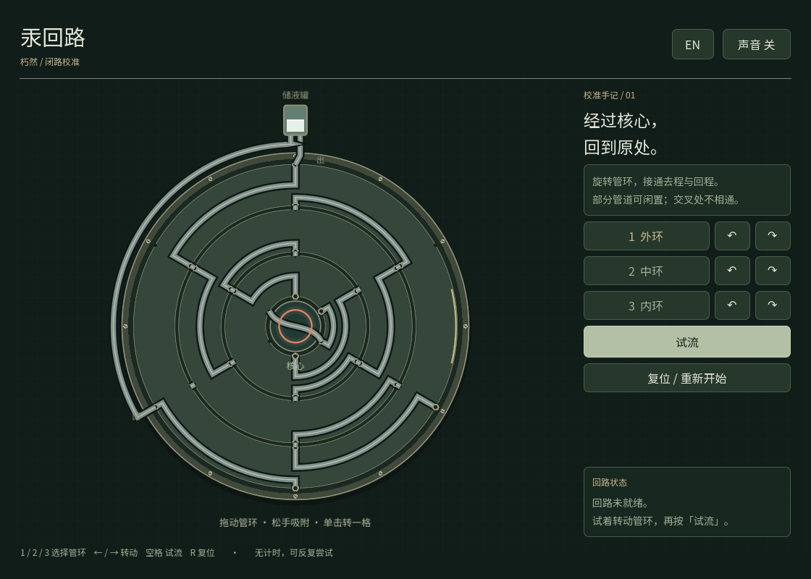

# The mercury puzzle prototype in Withered_still.

《朽然》独立水银谜题原型：**汞回路 / Mercury Return**。

原生 **Godot 4.7.2 Standard + GDScript** 工程。保留已确认网页版的全部管路布局、初始位置、试流规则和唯一解；加入直接拖动管环、60° 吸附、单击转动、重置、中英切换与轻量音效。



## 在 Mac 上打开

1. 在仓库页面点击 **Code → Download ZIP**，下载后解压。
2. 打开 **Godot 4.7.2**，在项目管理器点击 **Import / 导入**，选择文件夹里的 **`project.godot`**。
3. 等待首次导入字体和图标完成，点击编辑器右上角的 **▶ 运行项目**，或按 **F5**（部分 Mac 键盘需要 Fn + F5）。

不需要安装插件、.NET 或导出模板。项目自带所需字体；可离线运行。

## 怎么玩

让水银从顶部储液罐出发，**经过中央核心，再从另一条路径返回同一个储液罐**。部分管道可以闲置。视觉上的交叉不是连接点，只有管口对齐才会导流。

| 操作 | 效果 |
| --- | --- |
| 拖动任意管环 | 自由顺时针或逆时针旋转，松手吸附到最近的 60° 档位 |
| 单击管环 | 顺时针转动一格 |
| 右侧 ↶ / ↷ | 对应管环逆时针 / 顺时针转动一格 |
| 试流 | 水银沿真实连通路径流动；遇断口停下并显示红色标记 |
| 复位 / 重新开始 | 恢复原始布局；也可中断正在进行的试流 |
| EN / 中文 | 切换界面语言 |
| 声音 开 / 关 | 开关操作与完成音效 |

键盘：`1 / 2 / 3` 选环，`← / →` 转动，`空格` 试流，`R` 复位。键盘焦点在按钮上时，空格会激活该按钮；点击管环后可继续使用棋盘快捷键。

通关时核心指示环变蓝，出现「闭路校准完成」。没有倒计时，没有失败惩罚，可以反复调整与试流。成功后也可以继续转环或重玩。

## 工程结构

```text
project.godot
scenes/mercury_puzzle.tscn       独立可复用场景
scripts/circuit_model.gd        管口、连通关系与路径追踪
scripts/circuit_board.gd        原生绘制、拖动、吸附与水银动画
scripts/mercury_puzzle.gd        界面、文案、快捷键和声音
assets/fonts/                  随工程提供的中英文字体与授权
tests/test_model.gd             全部 216 个状态与网页版逐项等价检查
tests/test_puzzle.gd            输入事件、状态切换、路径几何与复位测试
docs/INTEGRATION.md             接入房间的方法与验证说明
```

## 运行验证

在工程目录执行（`godot` 指你安装的 Godot 4.7.2 可执行程序）：

```sh
godot --headless --editor --import --quit
godot --headless --script tests/test_model.gd
godot --headless --script tests/test_puzzle.gd
```

首次导入后，可直接按 F5 玩；上面的命令只用于开发验证。

已在 Linux 的 Godot **4.7.2.stable.official.ed1daf0bf** 中完成无界面测试与实际 OpenGL 渲染检查，包括中文 / 英文、失败 / 通关状态以及较小窗口。Mac 上的实际手感仍由你试玩确认。

这是一个独立谜题原型。房间探索、日期输入、道具栏、侦探笔记本和剧情转场在《朽然》主体工程中另行接入。默认画面为程序绘制的深绿金属仪器风格，方便之后替换正式美术。

字体基于 Noto Sans SC，按本原型文字取子集并改名为 Mercury Sans；授权见 `assets/fonts/OFL.txt`。机械轻响和完成音由程序合成。
